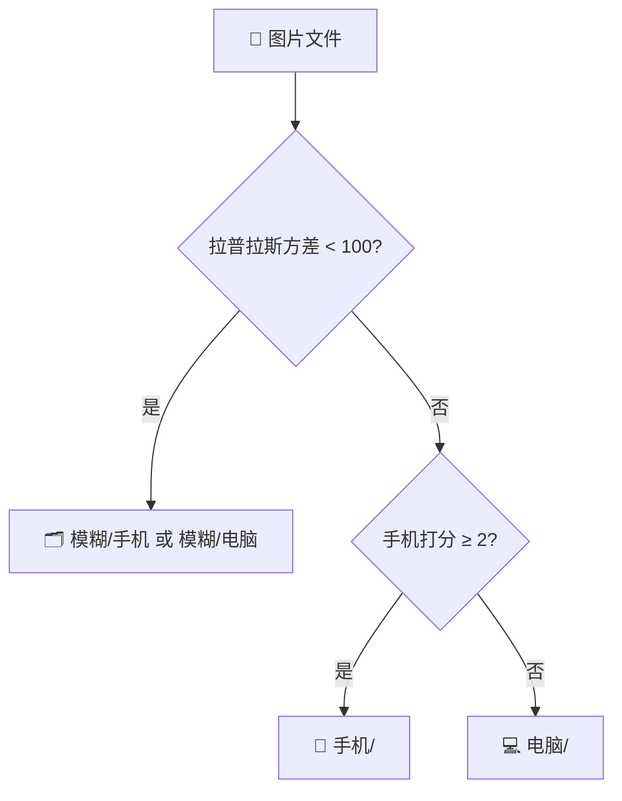

# 📦 图片分类工具 (image-classifier)

一键将压缩包（ZIP / TAR / TAR.GZ / TAR.BZ2 / TAR.XZ / 7Z / RAR）内的图片按 **手机图片**、**电脑图片**、**模糊图片** 自动分类，输出分类压缩包（7Z / RAR 会回退为 ZIP）。

**目录**：[快速开始](#quickstart) · [核心功能](#features) · [项目结构](#structure) · [分类规则](#rules) · [输出结构](#output) · [可调参数](#params) · [使用方式](#usage) · [运行示例](#example) · [依赖](#deps) · [退出码](#exitcodes) · [常见问题](#faq) · [已知限制](#limits) · [排错](#troubleshooting)

---

<a id="quickstart"></a>
## 🚀 快速开始

在 Linux VPS 上执行：

```bash
bash <(curl -sSL https://raw.githubusercontent.com/chihirosyd/image-classifier/main/install.sh)
```

脚本会自动：检测网络 → 下载代码 → 启动交互菜单 → 引导你完成环境安装和图片分类。

---

<a id="features"></a>
## ✨ 核心功能

| 功能 | 说明 |
|------|------|
| 🗜️ 多格式 | 支持 ZIP / TAR / TAR.GZ / TAR.BZ2 / TAR.XZ / 7Z / RAR 压缩包 |
| 📱 智能分类 | 按 EXIF 厂商 / 软件 / 宽高比 / 尺寸加权打分（≥2 判手机），无 EXIF 时退回宽度+竖屏规则 |
| 🔍 模糊检测 | OpenCV 拉普拉斯方差（先缩放到长边 512 再计算，阈值 100） |
| ⚡ 并行处理 | 多进程并行分类，自动检测 CPU 核心数（实际进程数见启动信息） |
| 📊 实时进度 | 每 500 张打印一次，显示速度 + 预计剩余时间（ETA） |
| 📄 分类清单 | 归档内附 `manifest.csv`（原路径 / 分类 / 清晰度分数 / 宽 / 高 / 原因）
| 💾 磁盘预估 | 运行前检查临时+输出双分区空间，不足时告警 |
| 🧹 清理策略 | 正常结束 / 用户中断自动清理；**运行出错时保留临时目录并打印路径**，便于抢救 |
| 🌐 网络自适应 | GitHub 直连 → ghproxy 镜像 → 自定义镜像，三级降级 |
| ☕ 低优先级 | 支持 `nice -n 19` 降低 CPU 优先级 |
| 🖥️ 后台运行 | 集成 `screen`，断开 SSH 任务不中断 |

---

<a id="structure"></a>
## 📁 项目结构

```
image-classifier/
├── classify.py      # Python 核心分类引擎
├── classifier.sh    # Bash 交互式管理菜单
├── install.sh       # 一键安装脚本
├── config.json      # 默认配置文件
├── requirements.txt # Python 依赖清单
├── tests/           # 单元测试（python -m unittest discover -s tests）
├── .github/workflows/ci.yml # CI：编译 + 单测 + shell 语法
├── .gitignore       # Git 忽略规则
├── VERSION          # 版本号
├── CHANGELOG.md     # 更新日志
└── README.md        # 说明文档
```

---

<a id="rules"></a>
## 🎯 分类规则详解



| 类别 | 判定条件 |
|------|----------|
| **模糊** | 清晰度分数 < 阈值（先缩放到长边 512），再按手机打分细分为 `模糊/手机`、`模糊/电脑` |
| **手机** | 清晰 + 手机打分 ≥ 2 |
| **电脑** | 清晰 + 手机打分 < 2 |

手机打分（`phone_score()`）的权重：

| 信号 | 分值 |
|------|:--:|
| EXIF Make/Model 命中手机厂商（Apple/HUAWEI/Xiaomi/OPPO/vivo/samsung…） | **+3** |
| EXIF Make/Model 命中相机厂商（Canon/NIKON/SONY/FUJIFILM…） | **−3** |
| EXIF Software 含 Android / iOS | **+2** |
| EXIF Software 含微信 / QQ / 微博 / 美图 / Snapseed | **+1** |
| 文件名以 `Screenshot` / `mmexport` / `wx_camera` 等开头 | **+1** |
| 竖屏比例 `height/width ≥ 1.25` | **+1** |
| `width ≤ 1200` 且竖屏 | **+1** |
| 长边 < 200px（图标/精灵图） | **−2** |

> 没有 EXIF 的图片会自动退化为「竖屏比例 + 宽度」两项，与旧规则基本一致；仅近乎正方形的图（如 1100×1200）会从「手机」变为「电脑」。

---

<a id="output"></a>
## 📂 输出结构

```
classified_20261023_193000_images.zip
├── 手机/
├── 电脑/
├── 模糊/
│   ├── 手机/
│   └── 电脑/
├── 无法读取/                  # 解码失败的图片，原样保留
└── manifest.csv               # 原路径,分类,清晰度分数,宽,高,原因
```

- 原压缩包内的子目录会保留（例如 `手机/2024/旅行/a.jpg`），不会拍平。
- 某个类别为 0 时，空目录仍会写进归档。
- `manifest.csv` 使用 UTF-8-SIG，Excel 直接打开不乱码；以 `=` `+` `-` `@` 开头的单元格会前置单引号，防止公式注入。
- 7z/rar 输入输出为 zip，目录结构不变；zip/tar/tar.gz/tar.bz2/tar.xz 保持原格式。
- 同名文件不会被覆盖：同目录下冲突时追加 `_2`、`_3`。

---

<a id="params"></a>
## ⚙️ 可调参数

参数支持三种方式设置（**优先级从高到低**）：

```
命令行参数  >  配置文件(config.json)  >  代码默认值
```

### 方式一：交互式菜单调整（推荐）

```bash
bash classifier.sh  →  选择 [4] 调整分类参数
```

按提示输入新值，直接回车保留当前值，自动保存到 `config.json`。

### 方式二：命令行参数

```bash
python classify.py 图片.zip --phone-width 1200 --blur-threshold 80 --log-interval 200
```

### 方式三：配置文件

仓库已包含默认 `config.json`，可直接修改或用菜单覆盖：

```json
{
  "phone_max_width": 1200,
  "blur_threshold": 100,
  "log_interval": 500,
  "workers": 0,
  "temp_dir": "",
  "output_dir": ""
}
```

> `workers: 0` 表示自动检测 CPU 核心数；`temp_dir: ""` 表示使用系统临时目录。

### 参数说明

| 参数 | 默认值 | 说明 |
|------|:--:|------|
| `phone_max_width` | 1200 | 手机判定最大宽度（像素）；宽度≤此值且竖屏时 +1 分 |
| `blur_threshold` | 100 | 模糊敏感度：越低越宽松，越高越严格 |
| `log_interval` | 500 | 每处理多少张打印一次进度 |
| `workers` | 0 | 并行进程数，0=自动检测，设为 1 可禁用并行；实际会按图片数与可用内存自动收紧 |
| `temp_dir` | "" | 临时目录路径，留空=系统默认（如 /tmp） |
| `output_dir` | "" | 输出目录路径，留空=脚本目录下的 output/ |

### 其他 CLI 选项

```bash
python classify.py --show-config          # 查看当前生效的配置
python classify.py --save-config          # 将当前参数保存为 config.json
python classify.py --config my.json ...   # 指定配置文件路径
python classify.py --workers 4 ...        # 指定并行进程数（与 --no-parallel 互斥）
python classify.py --no-parallel ...      # 禁用并行处理
python classify.py --executor thread ...  # 并行执行器：process（默认）或 thread
python classify.py --temp-dir /opt/tmp ... # 指定临时目录
python classify.py --output-dir /data/out ... # 指定输出目录（简写 -o）
python classify.py 图片包.zip --blur-stats  # 只统计清晰度分数分布（标定阈值用，不分类不打包）
python classify.py --version              # 显示版本号
```

> `--workers` 与 `--no-parallel` 不能同时使用；并行上限为 `max(2×CPU 核数, 16)`。

---

<a id="usage"></a>
## 📋 使用方式

### 方式一：交互式菜单（推荐）

```bash
bash classifier.sh
```

```
========================================
      图片分类工具 vX.X
========================================
1) 环境准备（创建虚拟环境 + 安装依赖）
2) 运行图片分类（支持 screen 后台）
3) 查看任务状态/进度
4) 调整分类参数
5) 查看当前配置
6) 清理环境（删除虚拟环境）
7) 更新脚本
0) 退出
========================================
```

> 菜单 [3] 读取 `logs/job.json`（最近一次任务的阶段/进度/进程状态），前台运行、已完成或失败的任务也能查看；未安装 `screen` 时只跳过会话列表。

### 方式二：命令行直接运行

```bash
# 先安装依赖
python3 -m venv classify_env
source classify_env/bin/activate
pip install opencv-python-headless numpy pillow
# HEIC/HEIF 支持（可选）
pip install pillow-heif

# 运行分类
python3 classify.py 图片包.zip
# → 输出 classified_20260803_150530_图片包.zip（classified_时间戳_源文件名）
```

---

<a id="example"></a>
## 📊 运行示例

```
当前参数：手机宽度≤1200px | 模糊阈值=100 | 进度间隔=500张 | 进程=3（并行，CPU 4 核）
临时目录: /tmp
输出目录: /home/user/image-classifier/output
==================================================
磁盘空间检查
==================================================
压缩包大小: 2.35 GB（解压后预估 5.88 GB）
输出包预估: 约 5.88 GB（按解压后大小保守估计）

📁 工作分区（当前临时与输出位于同一硬盘分区中）:
  总 50.00 GB | 可用 32.50 GB
  峰值需求: 12.76 GB（解压 5.88 + 输出 5.88 + 安全余量 1GB）

✅ 磁盘空间充足，可以安全运行。
输出文件: /home/user/image-classifier/output/classified_20260803_150530_images.zip

正在解压 /home/user/image-classifier/input/images.zip ...
  解压完成。

正在扫描图片文件...
共发现 8421 张图片，开始分类...
  使用 3 个并行进程进行分类（--executor=process）...

  [500/8421] 手机:200 电脑:250 模糊:45 错误:5 | 7.3 张/秒 | 预计剩余 1085s
  [1000/8421] 手机:410 电脑:480 模糊:100 错误:10 | 7.3 张/秒 | 预计剩余 1017s
  ...

==================================================
分类完成！总耗时 1153 秒 | 平均 7.3 张/秒
==================================================
  📱 手机 :   3200 张
  💻 电脑 :   4500 张
  🔍 模糊 :    680 张
  ❌ 错误 :     41 张
  📦 合计 :   8421 张

  ⚠️  41 张图片无法读取，已放入「无法读取/」目录（失败原因见日志与 manifest.csv 的「原因」列）

正在创建分类压缩包 /home/user/image-classifier/output/classified_20260803_150530_images.zip ...
  打包完成。
  归档内共 8422 个文件（8421 张图片 + manifest.csv）。
全部完成！请下载: /home/user/image-classifier/output/classified_20260803_150530_images.zip
```

> 上例为实际格式示意：进程数由 `cpu_count <= 4 → max(2, cpu_count-1)` 决定，4 核即 3；错误图片会保留在 `无法读取/`，不会丢弃。

---

<a id="deps"></a>
## 📦 依赖

| 依赖 | 用途 | 安装 |
|------|------|------|
| Python 3.10+ | 运行环境 | 系统自带或 `apt install python3` |
| bash 4.0+ | 菜单脚本（`${var,,}` 需要） | 一般自带；macOS 自带 3.2，需 `brew install bash` |
| opencv-python-headless | 图像读取 + 拉普拉斯方差 | `pip install opencv-python-headless` |
| numpy | cv2 传递依赖 | 随 opencv 自动安装 |
| pillow | EXIF 读取 + cv2 读不了的格式兜底（ICO / TGA / PSD） | `pip install pillow` |
| pillow-heif | HEIC / HEIF 解码（可选）；未安装时启动会告警并归入 `无法读取/` | `pip install pillow-heif` |
| screen | 后台运行（可选） | `apt install screen` |

依赖版本范围见 `requirements.txt`，可一次性安装：`pip install -r requirements.txt`（HEIC 支持需取消其中 `pillow-heif` 的注释）。

安装与自更新会在覆盖文件前用仓库根目录的 `SHA256SUMS` 逐个校验（等价于 `sha256sum -c`）：清单缺项、哈希不匹配或缺少 `sha256sum` 命令时一律中止，不会写入任何文件。所有下载链路强制 HTTPS（`--proto '=https' --proto-redir '=https'`）。macOS 默认没有 `sha256sum`，脚本会自动回退到 `shasum -a 256`；两者都缺失时才会中止安装。

校验和按**仓库内容（LF 换行）**口径计算：CI 闸门与 `install.sh` 都会先把 `\r\n` 归一为 `\n` 再比对，所以 Windows 上用 CRLF 工作副本也不会误报；但如果你手工执行 `sha256sum -c SHA256SUMS`，请先把工作副本还原成 LF（`git checkout -- .` 或 `git config core.autocrlf input`）。

---

<a id="faq"></a>
## ❓ 常见问题

<details>
<summary><b>Q: 模糊阈值 100 是否合适？</b></summary>

默认值 100 对大多数场景适用。如果模糊图太多，降低阈值（如 50）；如果模糊图太少，提高阈值（如 200）。运行后查看 `模糊/` 文件夹，根据结果微调。

分数是「缩放到长边 512 后的拉普拉斯方差」，与图片原始分辨率无关。想定量标定可以先跑一次：

```bash
python classify.py 图片包.zip --blur-stats
```

它会打印当前包的分数分布（P5/P10/P25/中位数…）以及低于当前阈值的比例，再据此定阈值。
</details>

<details>
<summary><b>Q: 支持哪些图片格式？</b></summary>

`.jpg` `.jpeg` `.jfif` `.png` `.gif` `.bmp` `.webp` `.tiff` `.tif` `.tga` `.avif` `.ico` `.psd` `.heic` `.heif`，共 15 种。

其中 `.ico` / `.tga` / `.psd`（仅合成预览）由 Pillow 兜底；`.heic` / `.heif` 需额外安装 `pillow-heif`，`.avif` 需 Pillow ≥ 11.3。能力缺失时启动会打印告警（含数量），这些文件会归入 `无法读取/` 而不是直接丢弃。
</details>

<details>
<summary><b>Q: 超大压缩包会不会爆内存？</b></summary>

不会。图片**逐张读取处理**，不会一次性加载所有图片到内存。解压需要磁盘空间：脚本按归档内文件大小求和估算（读不到元数据时回退 2.5× 压缩包大小），运行前就会检查并提示。
</details>

<details>
<summary><b>Q: 支持哪些压缩格式？</b></summary>

`.zip` `.tar` `.tar.gz` `.tgz` `.tar.bz2` `.tbz2` `.tar.xz` `.7z` `.rar`。输出格式默认与输入一致（7z/rar 通过 7z 解压，输出回退为 zip）。其中 7z 需 `p7zip-full`，`install.sh` 会自动提示安装。
</details>

<details>
<summary><b>Q: 国内 VPS 下载慢怎么办？</b></summary>

`install.sh` 已内置 ghproxy 镜像自动切换；菜单里装依赖失败时也会自动重试并回退阿里云镜像。手动安装可设 pip 镜像：

```bash
pip install -i https://mirrors.aliyun.com/pypi/simple/ opencv-python-headless numpy
```

脚本内置的备用镜像同样可以用环境变量覆盖：`CLASSIFY_PIP_INDEX=https://pypi.tuna.tsinghua.edu.cn/simple/`（**置空** `CLASSIFY_PIP_INDEX=` 则禁用镜像回退、只用默认源）。安装时会打印实际使用的镜像地址。
</details>

<a id="exitcodes"></a>
## 🔢 退出码

| 退出码 | 含义 |
|---|---|
| `0` | 成功（含空归档等「正常结束」场景） |
| `1` | 失败（文件不存在、依赖缺失、解压被上限拒绝、打包失败、运行中异常） |
| `2` | 未处理：磁盘空间不足后放弃、用户主动取消（按 q / 放弃覆盖），没有产出任何结果 |

`classifier.sh` 会把非 0 退出码显示出来，退出码 2 会额外提示「未处理」。中断（Ctrl-C / SIGTERM）按「已处理部分结果」处理，退出码为 `1`，临时目录会保留以便抢救。

<a id="limits"></a>
## ⚠️ 已知限制

- **HEIC/HEIF**：需安装 `pillow-heif`（`pip install pillow-heif`），否则归入 `无法读取/`；启动时会打印告警与数量。
- **PSD**：只读取已合并的预览图；分层或没有合成预览的文件会失败。
- **7z/RAR**：需要 `p7zip-full`；输出会回退为 ZIP。该格式拿不到逐条目元数据，因此「条目数 20 万 / 单条目 8 GiB」两项上限对它不生效，只按解压后总量估算校验。
- **RAW / SVG**：不支持（`.cr2/.nef/.arw/.dng/.svg` 不会被当作图片处理）。
- **动图**：GIF / WebP 只取第一帧。
- **清晰度阈值**：分数基于长边 512 的归一化图，建议先跑一次 `--blur-stats` 按自己的图库标定；默认 100。
- **平台**：面向 Linux；macOS 需 bash ≥ 4.0（系统自带 3.2 不支持 `${var,,}`，可 `brew install bash`），并需 Python 3.10+。
- **并发**：实际进程数会按图片数与可用内存自动收紧，不保证等于 `workers`。
- **本次未验证**：`bash -n` 语法检查、`.7z/.rar` 内的软链接与 `..` 穿越、`.jxl/.avif` 的实际解码率、真实 Windows 控制台的编码行为——这些项在开发环境无法执行，交由 CI 与真实环境确认。

<a id="troubleshooting"></a>
## 🧯 排错

| 现象 | 排查 |
|---|---|
| 输出包很小 / 为空 | 先看归档里的 `无法读取/`，再看日志 `logs/classify_*.log`（用了 `--output-dir` 时日志在该目录下的 `logs/`，也可用 `--log-dir` 指定） |
| 少了很多图 | 是否 HEIC（缺 `pillow-heif`）或 `.7z/.rar`（缺 `p7zip-full`） |
| 看不到后台进度 | 菜单 [3] 读安装目录下的 `logs/job.json`（该文件位置固定，不随 `--output-dir` 变化）；前台已完成任务也能看；未装 screen 只会跳过会话列表 |
| 依赖安装失败 | 已自动重试并回退阿里云镜像；仍失败看 `pip install -r requirements.txt` 的输出 |
| 输出目录不可写 | 用 `--output-dir /可写路径`（简写 `-o`） |
| 空间不足 | 把临时目录换到输出分区：`--temp-dir /data/tmp` |
| 出错后想找回结果 | 程序会保留临时目录并打印路径（不会自动删除），可手动抢救 |
| 装到了 `/root` | 用普通用户执行安装；`sudo` 时脚本会优先装到 `$SUDO_USER` 的家目录 |

---
